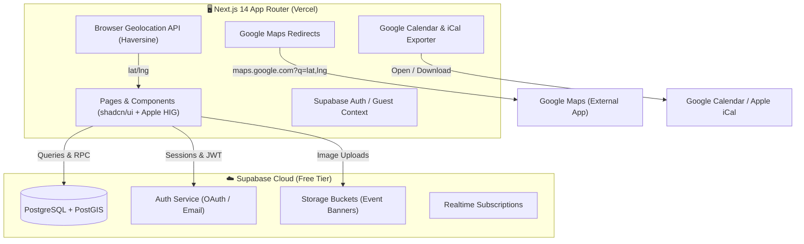

# 📡 EventRadar — Hyperlocal Event Discovery

> **Hackathon:** VECNAVERSE 2026 (24-Hour Non-stop Build)  
> **Mission:** Connect people with tech hackathons, founder meetups, live acoustic gigs, and cultural workshops happening right in their neighborhood.


---

## ⚡ Highlights & Innovations

* **📍 Hyperlocal GPS Discovery:** 1-click browser geolocation auto-detection that snaps to the nearest Indian metro (Bengaluru, Mumbai, Delhi NCR, Hyderabad, Pune, Chennai, etc.) and computes exact Haversine distances to venues in real-time.
* **🍏 Apple Human Interface Design:** Crafted according to Apple's WWDC fluid interface standards — translucent glassmorphism (`backdrop-filter: blur(24px) saturate(190%)`), light-catching 1px borders, tactile pointerdown feedback (`active:scale-[0.97]`), optical typography, and accessibility fallbacks (`prefers-reduced-motion` & `prefers-reduced-transparency`).
* **🗺️ 100% Free Turn-by-Turn Navigation:** Zero paid mapping dependencies — seamless deep links into Google Maps (`maps.google.com?q=lat,lng`) for instant directions.
* **🎉 Instant RSVP & Tactile Feedback:** 1-click spot reservation with live celebration particle physics (`canvas-confetti`), capacity tracking, and ticket badges.
* **📅 1-Click Calendar Sync:** Export events straight to Google Calendar or download standard `.ics` files for Apple Calendar / Outlook.
* **💬 Real-Time Community Wall:** Interactive discussion and Q&A feed on every event page connecting attendees directly with hosts.
* **📊 Host Analytics & Event CRUD:** Dedicated organizer dashboard (`/profile/my-events`) tracking RSVPs, total attendance rates, estimated impressions, with inline Edit and Delete modals.

---

## 🏗️ System Architecture



---

## 👥 Team Work Division

| Role | Team Member | Territory & Responsibilities |
|---|---|---|
| **Frontend Lead & UI** | **Person A** | Next.js App Router, shadcn/ui, Apple glassmorphism styling, responsive layout, EventCard, Explore filters, Event Details, RSVP flow, Community Wall, and Google Maps integration. |
| **Backend & DB Lead** | **Person B** | Supabase setup, PostgreSQL schema, PostGIS spatial RPCs (`get_nearby_events`), Row Level Security (RLS) policies, and seed data. |

---

## 🛠️ Tech Stack (100% Free Tier)

| Layer | Technology | Purpose |
|---|---|---|
| **Framework** | [Next.js 14 (App Router)](https://nextjs.org/) | React 19 SSR, Partial Prerendering, Turbopack |
| **Language** | [TypeScript](https://www.typescriptlang.org/) | Strict type safety across components and events |
| **Styling** | [Tailwind CSS v4](https://tailwindcss.com/) + [shadcn/ui](https://ui.shadcn.com/) | Accessible primitives with custom Apple HIG glass tokens |
| **Database & Auth** | [Supabase](https://supabase.com/) | PostgreSQL, PostGIS spatial queries, and `@supabase/ssr` |
| **Icons** | [Lucide React](https://lucide.dev/) | Clean, lightweight optical icons |
| **Feedback** | [Sonner](https://sonner.emilkowal.ski/) & [Canvas-Confetti](https://www.npmjs.com/package/canvas-confetti) | Rich toast notifications & interactive celebration bursts |
| **Theme** | [next-themes](https://github.com/pacocoursey/next-themes) | Seamless light & dark mode support |

---

## 📁 Project Directory Structure

```
event-radar/
├── app/
│   ├── layout.tsx              # Root shell with providers, navbar & footer
│   ├── page.tsx                # Hero, radar beacon, city picker, trending events
│   ├── explore/
│   │   └── page.tsx            # Multi-parameter filterable event discovery
│   ├── event/
│   │   └── [id]/
│   │       └── page.tsx        # Event details, Google Maps link, RSVP & Q&A
│   ├── create/
│   │   └── page.tsx            # Event publishing form with dropzone & tags
│   ├── profile/
│   │   ├── page.tsx            # User interests & RSVP history
│   │   └── my-events/
│   │       └── page.tsx        # Organizer dashboard with analytics & edit/delete
│   └── globals.css             # Apple glassmorphism, radar animations & tokens
├── components/
│   ├── ui/                     # shadcn UI primitives (button, card, dialog, etc.)
│   ├── events/
│   │   ├── EventCard.tsx       # Event preview card with distance and map link
│   │   ├── EventDetailClient.tsx # Interactive event detail engine
│   │   └── GoogleMapsLink.tsx  # Free Google Maps coordinates launcher
│   ├── layout/
│   │   ├── Navbar.tsx          # Floating Apple glassmorphism header & GPS trigger
│   │   └── Footer.tsx          # Minimalist footer with hackathon credits
│   ├── auth/
│   │   └── AuthProvider.tsx    # Supabase session & instant guest demo mode
│   └── providers/
│       ├── CityProvider.tsx    # Geo-location state & Haversine distance engine
│       ├── EventsProvider.tsx  # Unified CRUD state with localStorage persistence
│       └── ThemeProvider.tsx   # Light/dark mode system
└── lib/
    ├── constants.ts            # Indian metro directory, categories & mock events
    ├── utils.ts                # Tailwind class merge utility
    └── supabase/
        ├── client.ts           # Browser Supabase SDK client
        └── server.ts           # Server-side Supabase client
```

---

## 🚀 Getting Started

### 1. Prerequisites
- Node.js `v20+` or `v24+`
- npm `v10+`

### 2. Installation
```bash
# Clone the repository
git clone https://github.com/your-username/GeoGuild.git
cd GeoGuild

# Install dependencies
npm install
```

### 3. Environment Setup
Create a `.env.local` file in the root directory:
```env
NEXT_PUBLIC_SUPABASE_URL=https://your-project.supabase.co
NEXT_PUBLIC_SUPABASE_ANON_KEY=your-anon-key
```
*(Note: If Supabase credentials are not provided, EventRadar automatically runs in full **Demo / Mock Mode** with 8 pre-seeded Indian metro events and local persistence!)*

### 4. Run Development Server
```bash
npm run dev
```
Open [http://localhost:3000](http://localhost:3000) in your browser.

### 5. Production Build & Lint
```bash
# Verify ESLint rules
npm run lint

# Build production bundle
npm run build
```

---

## 🏆 Hackathon Judges' Quick Tour

1. **Auto-Detect GPS:** Click **"Auto-Detect My City"** in the top navigation bar or hero dropdown to see real-time distance calculations.
2. **Filter by Distance & Date:** Go to `/explore` and choose **"Within 10 km"** and **"This Weekend"** to see live Haversine filtering.
3. **Turn-by-Turn Navigation:** Click **"Open Location in Google Maps"** on any event to see seamless free navigation without paid API keys.
4. **Reserve a Spot:** Click **"RSVP Now"** to experience the celebration particle burst and watch capacity counters update.
5. **Sync to Calendar:** Use **"Google Calendar"** or **"iCal (.ics)"** to export event schedules.
6. **Publish an Event:** Visit `/create` to drag and drop a banner image and select tags.
7. **Host Analytics:** View attendance statistics on `/profile/my-events` and edit or delete events in real-time.

---

*Built with ❤️ during the VECNAVERSE 24-Hour Hackathon 2026.*
